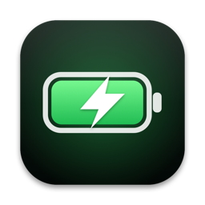
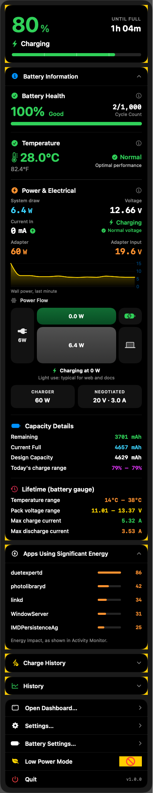
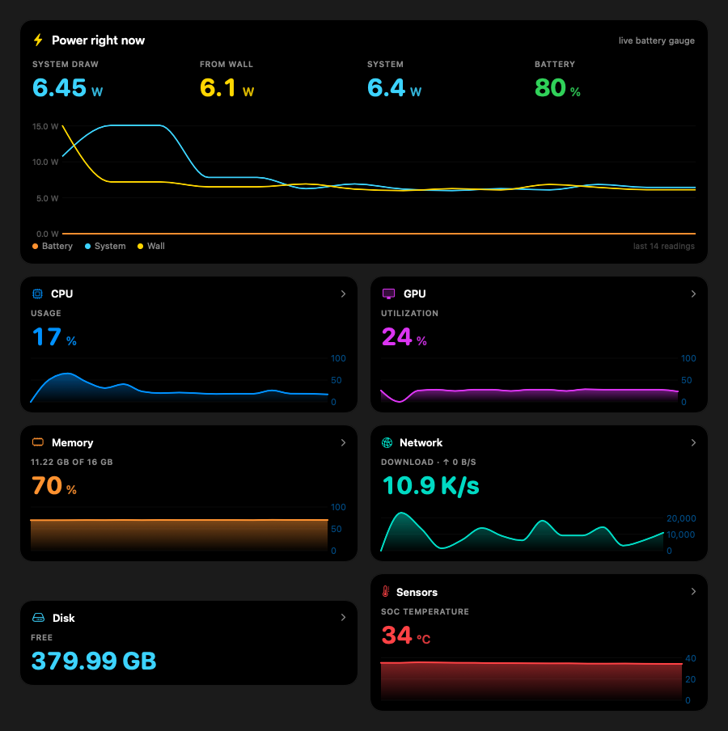
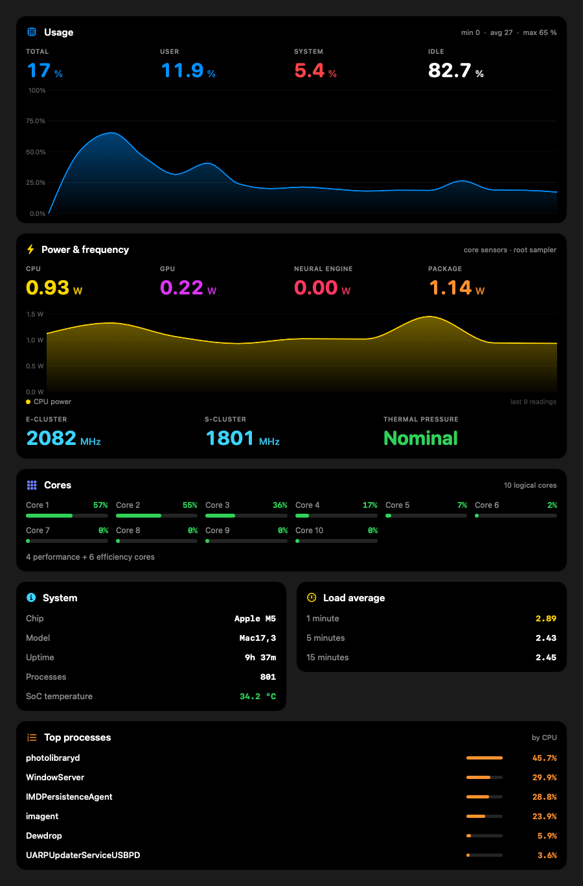

<p align="center"></p>

# Dewdrop


A menu bar battery and system monitor for macOS: live wattage, battery health, charger details, and Stats-style CPU, GPU, memory, disk, network and sensor readouts, in one app. No Xcode project, no dependencies.

> Windows version: [MTMAG11/BatteryMonitor](https://github.com/MTMAG11/BatteryMonitor)

## Screenshots


| Battery dropdown | Dashboard |
|---|---|
|  |  |



## Features

**Battery**
- **Live power:** battery watts, voltage, current and temperature read from the battery gauge once a second, so the numbers follow what you are doing.
- **Power flow:** wall → battery / system, with measured adapter draw, conversion losses, and the charger's rated and negotiated profile (for example 20 V · 3 A).
- When plugged in and held at your charge limit, the headline number switches to what the Mac is drawing instead of showing 0 W.
- **Health:** max capacity vs design capacity, cycle count, today's charge range, and gauge lifetime stats (temperature range, pack voltage range, max charge and discharge current).
- **History:** a daily battery-health record and a log of every charge and on-battery session (start/end, level change, Wh, average and peak watts). CSV export.
- **Apps using significant energy** (Activity Monitor's Energy Impact), connected Bluetooth device batteries.
- **Alerts:** unplug-at-limit and low-battery notifications, plus animated on-screen pop-ups for plug-in, unplug, low, critical, fully charged and charge limit.

**System (a Stats-style replacement)**
- CPU (per core, load average, top processes), GPU (utilization and power), memory (breakdown, swap, pressure), disk (volumes, read/write, top I/O), network (speeds, Wi-Fi, top processes), sensors (SoC / NAND / battery temperatures), fans (if the Mac has any) and a multi-time-zone clock.
- **Menu bar widgets:** label-over-value, text, bar, line graph, ring, battery pill, up/down speeds. Each module is its own menu bar item, or merge several into one.
- **Dashboard window** with a page per module, live charts and detail.
- Reorderable, hideable dropdown sections: drag them, or right-click for Move to Top.
- Threshold alerts for CPU, memory, free disk space and SoC temperature.

**Optional core sensors (needs admin once)** adds CPU / GPU / Neural Engine power in watts, CPU and GPU frequency, and thermal pressure. See [Core sensors](#core-sensors-admin).

## Download

Get **Dewdrop-x.y.z.dmg** from the [Releases](https://github.com/MTMAG11/Dewdrop/releases) page, open it and drag Dewdrop onto Applications. A plain zip is attached too. The app is ad-hoc signed, not notarized, so macOS will warn on first launch: right-click the app and choose **Open**, or run:

```bash
xattr -dr com.apple.quarantine /Applications/Dewdrop.app
```

## Requirements

- macOS 14 or later
- Developed and tested on a MacBook with an Apple M5 on macOS 27. Other Apple Silicon Macs should work, but some readings come from undocumented SMC keys that vary between models, and anything unavailable is hidden rather than guessed. Intel Macs are untested.
- To build: the Xcode Command Line Tools (`xcode-select --install`). Full Xcode is not required.

## Build from Source

```bash
git clone https://github.com/MTMAG11/Dewdrop.git
cd Dewdrop
./build.sh            # builds Dewdrop.app next to the script
./build.sh install    # builds, replaces /Applications/Dewdrop.app and relaunches it
```

`build.sh` compiles `Sources/*.swift` with `swiftc`, assembles the app bundle and ad-hoc signs it. A newly launched Dewdrop always replaces any older running copy, so updating never leaves duplicate menu bar icons.

## Making a release

1. Bump `VERSION` in `build.sh` and add an entry to `CHANGELOG.md`.
2. Run `./release.sh`. It builds the app, then writes `dist/Dewdrop-<version>.dmg`, `dist/Dewdrop-<version>.zip` and `dist/SHA256SUMS.txt`. (`./make_dmg.sh` alone rebuilds just the DMG. It lays the window out through Finder, so macOS may ask once to let your shell control Finder.)
3. Create a GitHub release for the `v<version>` tag and attach the files in `dist/`.

## Where it keeps its data

- Settings: `~/Library/Preferences/com.rishaan.dewdrop.plist`
- History: `~/Library/Application Support/Dewdrop/` (`history.json`, `health.json`, `sessions.json`)
- Core sensors helper (only if you enable it): `/Library/LaunchDaemons/com.rishaan.dewdrop.helper.plist` and `/Library/Application Support/Dewdrop/`

Nothing leaves your Mac. The one optional network call is the public-IP lookup (off by default, asks `api.ipify.org`).

## How the numbers are read

macOS exposes the battery's voltage and current through the IORegistry, but that copy only refreshes about once a minute. Dewdrop reads the battery gauge's own SMC keys instead (`B0AV`, `B0IV`, `B0AP`, `TB0T`), which update every second, plus the SMC's system and DC-in power sensors (`PSTR`, `PDTR`). The IORegistry is still used for capacity, cycle count, charger profiles and lifetime stats. GPU power comes from the IOReport energy counter. Temperatures come from the HID thermal sensors. Per-process lists use `ps`, `nettop` and `proc_pid_rusage`.

CPU and DRAM energy counters are not readable by normal apps on current macOS, which is why CPU watts need the helper below.

## Core sensors (admin)

CPU / GPU / Neural Engine watts, frequencies and thermal pressure only come from Apple's `powermetrics`, which needs root. Settings → Core sensors → **Enable** installs a small LaunchDaemon (macOS asks for your password in its own dialog):

- It runs `powermetrics` as a single stream, and **only while a Dewdrop dropdown or the dashboard is open**; otherwise it idles.
- It only reads sensors and writes one world-readable file. It changes nothing else.
- The script and daemon plist are in [`Resources/`](Resources), copied to root-owned locations at install time. **Remove** in the same tab uninstalls everything.

## Tech Stack

- Swift 5, SwiftUI + AppKit, Swift Charts (single-file modules in `Sources/`)
- IOKit (IORegistry, SMC, HID sensors, IOPS notifications), Mach host APIs, libproc, IOReport (via `dlopen`), CoreWLAN
- `UNUserNotificationCenter` for alerts, `SMAppService` for launch at login
- No third-party packages

## Acknowledgements

Inspired by [Juicy](https://getjuicy.app) and [Stats](https://github.com/exelban/Stats). Dewdrop is an independent project and is not affiliated with either. Research notes on reading power data came from open-source tools such as [macmon](https://docs.rs/crate/macmon/0.8.0).

## License

MIT, see [LICENSE](LICENSE).
